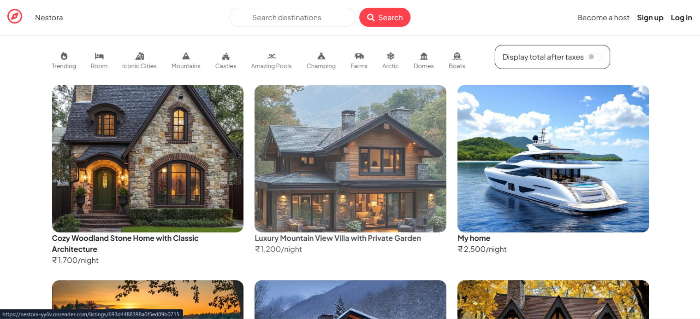
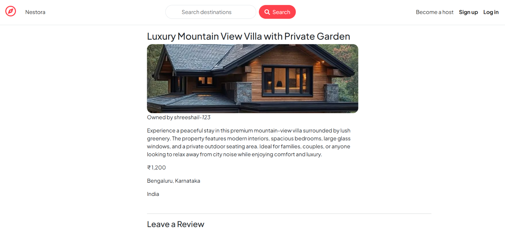
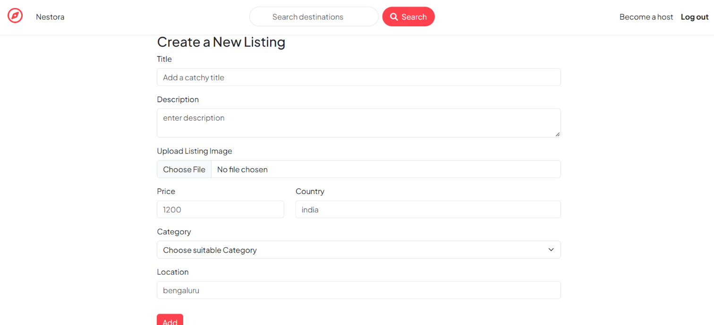
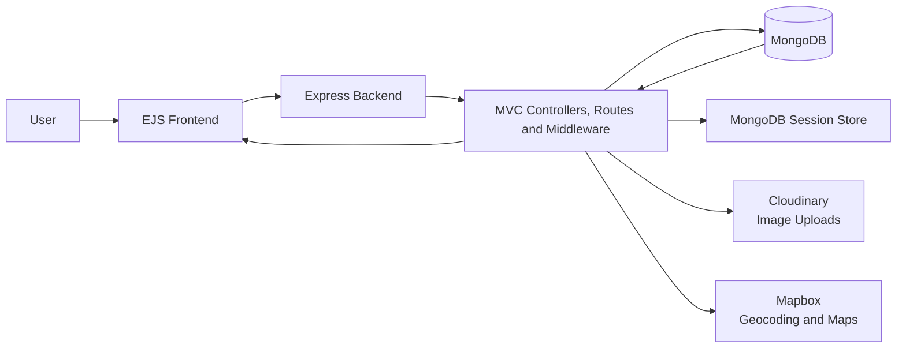

# Nestora


Nestora is a full-stack accommodation listing platform built with Node.js,
Express, MongoDB, Mongoose, EJS, and Passport.js. It enables authenticated
users to discover, search, create, edit, and review property listings with
Cloudinary image uploads and Mapbox-powered location data.

## Project Overview

Nestora follows a server-rendered MVC architecture:

- **Users** can register, log in, log out, browse listings, and submit reviews.
- **Listing owners** can create, edit, and delete their own listings.
- **Location data** is geocoded with Mapbox and displayed on listing maps.
- **Media assets** are uploaded and stored through Cloudinary.
- **Persistence** is managed with MongoDB and Mongoose, including MongoDB-backed
  sessions.

The application runs as an Express server on port `8080` and renders responsive
HTML pages with EJS and EJS Mate.

## Why This Project?

Nestora demonstrates production-oriented backend and full-stack development
patterns in a realistic marketplace-style application. It brings together
authentication, authorization, validation, CRUD workflows, relational
references in MongoDB, third-party API integrations, file uploads, and
server-side rendering in one cohesive project.

The project is suitable for portfolio review, internships, and placement
discussions because it shows how a feature-rich application can be structured
with clear MVC responsibilities and reusable middleware.

## Features

- User registration, login, logout, and persistent session authentication
- Passport Local authentication with Passport Local Mongoose
- Listing discovery with category filters and text search
- Listing CRUD operations with owner-based authorization
- Property categories including Trending, Rooms, Mountains, Castles, Farms,
  Arctic, Domes, Boats, and more
- Listing image uploads using Multer and Cloudinary
- Mapbox forward geocoding for listing locations
- Interactive listing maps with Mapbox GL
- Reviews with 1–5 star ratings and comments
- Review creation and author-only deletion
- Joi validation for listing and review payloads
- Flash messages for success and error feedback
- Centralized 404 and application error handling
- Responsive server-rendered EJS views
- MongoDB-backed session storage through Connect Mongo

## Screenshots

Add the following screenshots to `docs/screenshots/` to display the project
interface on GitHub:

### Home and Listing Discovery



### Listing Details



### Create Listing




## System Architecture



## Tech Stack

| Layer | Technology | Purpose |
| --- | --- | --- |
| Runtime | Node.js 20.18.0 | JavaScript runtime |
| Backend | Express 4.x | HTTP server, routing, and middleware |
| Frontend | EJS, EJS Mate, HTML, CSS, JavaScript | Server-rendered UI and layouts |
| Database | MongoDB, Mongoose 8.x | Document persistence and data modeling |
| Authentication | Passport.js, Passport Local, Passport Local Mongoose | Local authentication and session serialization |
| Sessions | Express Session, Connect Mongo | Secure persistent session storage |
| Validation | Joi | Request payload validation |
| File uploads | Multer, Multer Storage Cloudinary | Multipart processing and image storage |
| Media platform | Cloudinary | Listing image hosting |
| Location services | Mapbox SDK, Mapbox GL | Forward geocoding and interactive maps |
| Request utilities | Method Override, Connect Flash | HTML form verbs and user notifications |

## Resume Highlights

- Developed a full-stack accommodation marketplace using **Node.js, Express,
  EJS, and MongoDB** with a maintainable MVC architecture.
- Implemented **Passport.js local authentication** with persistent sessions,
  login redirects, logout handling, and protected routes.
- Built RESTful listing and review workflows with Express routers, controller
  modules, Mongoose references, and HTTP method overrides.
- Integrated **MongoDB and Mongoose** for users, listings, reviews, ownership
  relationships, geospatial coordinates, and cascading review cleanup.
- Added secure listing image uploads with **Multer and Cloudinary** storage.
- Integrated **Mapbox geocoding** to convert listing locations into GeoJSON
  coordinates and render them on interactive maps.
- Added Joi-based server-side validation, authorization middleware, flash
  messaging, and centralized error handling.
- Structured the codebase using reusable routes, controllers, models,
  middleware, utilities, and server-rendered views.

## Installation & Setup

### Prerequisites

- Node.js `20.18.0` or a compatible later version
- npm
- MongoDB Atlas or a local MongoDB server
- Cloudinary account and API credentials
- Mapbox access token

### Local installation

1. Clone the repository:

   ```bash
   git clone https://github.com/shreeshailSingare/nestora-booking-platform.git
   cd nestora-booking-platform
   ```

2. Install dependencies:

   ```bash
   npm install
   ```

3. Create a `.env` file using the variables described in
   [Environment Variables](#environment-variables).

4. Start the application:

   ```bash
   node app.js
   ```

5. Open [http://localhost:8080](http://localhost:8080).

### Seed sample listings

The repository includes sample listing data in `init/data.js`. The seed script
uses a local MongoDB database named `wanderlust`:

```bash
node init/index.js
```

Make sure MongoDB is running locally before executing the command. The script
deletes existing listings and assigns seeded records to the owner ID configured
in `init/index.js`; update that ID for a different local user.

> **Note:** `npm test` is currently the default placeholder script from
> `package.json`; no automated test suite is configured yet.

## Environment Variables

Create `.env` in the project root for local development. Never commit this
file or expose these credentials in client-side code.

| Variable | Required | Description |
| --- | --- | --- |
| `ATLASDB_URL` | Yes | MongoDB Atlas connection string used by `app.js` |
| `SESSION_SECRET` | Yes | Secret used to sign application sessions |
| `CLOUD_NAME` | Yes | Cloudinary cloud name |
| `CLOUD_API_KEY` | Yes | Cloudinary API key |
| `CLOUD_API_SECRET` | Yes | Cloudinary API secret |
| `MAP_TOKEN` | Yes | Mapbox access token for geocoding and maps |
| `NODE_ENV` | Recommended | Set to `development` locally and `production` when deployed |

Example:

```env
ATLASDB_URL=mongodb+srv://<username>:<password>@<cluster>/<database>
SESSION_SECRET=replace-with-a-long-random-secret
CLOUD_NAME=your-cloudinary-cloud-name
CLOUD_API_KEY=your-cloudinary-api-key
CLOUD_API_SECRET=your-cloudinary-api-secret
MAP_TOKEN=your-mapbox-access-token
NODE_ENV=development
```

## API Routes Documentation

Nestora exposes HTML-oriented REST routes consumed by the EJS frontend.

### Listings

| Method | Endpoint | Authentication | Description |
| --- | --- | --- | --- |
| `GET` | `/listings` | Public | Browse, filter, and search listings |
| `GET` | `/listings/new` | Required | Render the create-listing form |
| `POST` | `/listings` | Required | Create a listing and upload its image |
| `GET` | `/listings/:id` | Public | View a listing, reviews, and map |
| `GET` | `/listings/:id/edit` | Owner | Render the edit-listing form |
| `PUT` | `/listings/:id` | Owner | Update listing details or image |
| `DELETE` | `/listings/:id` | Owner | Delete a listing and its reviews |

### Reviews

| Method | Endpoint | Authentication | Description |
| --- | --- | --- | --- |
| `POST` | `/listings/:id/reviews` | Required | Add a rating and comment |
| `DELETE` | `/listings/:id/reviews/:reviewId` | Review author | Delete a review |

### Authentication

| Method | Endpoint | Authentication | Description |
| --- | --- | --- | --- |
| `GET` | `/signup` | Public | Render the registration form |
| `POST` | `/signup` | Public | Register and log in a user |
| `GET` | `/login` | Public | Render the login form |
| `POST` | `/login` | Public | Authenticate a user |
| `GET` | `/logout` | Authenticated user | End the current session |

## Database Schema Overview

### User

| Field | Type | Description |
| --- | --- | --- |
| `username` | String | Managed by Passport Local Mongoose |
| `email` | String | Required user email |
| `hash` / `salt` | String | Password credentials managed by Passport Local Mongoose |

### Listing

| Field | Type | Description |
| --- | --- | --- |
| `title` | String | Required listing title |
| `description` | String | Listing description |
| `image` | Object | Cloudinary `url` and `filename` |
| `price` | Number | Required non-negative price |
| `location` | String | User-provided location |
| `country` | String | Listing country |
| `category` | Enum | Supported listing category |
| `geometry` | GeoJSON Point | Mapbox-generated coordinates |
| `owner` | ObjectId | Reference to `User` |
| `reviews` | ObjectId[] | References to `Review` |

### Review

| Field | Type | Description |
| --- | --- | --- |
| `comment` | String | Required review text at validation time |
| `rating` | Number | Required value from 1 to 5 |
| `createdAt` | Date | Defaults to the creation time |
| `author` | ObjectId | Reference to `User` |

Deleting a listing also removes its associated reviews through a Mongoose
post-delete hook.

## Project Structure

```text
.
├── app.js                    # Express app, sessions, Passport, routes, errors
├── cloudConfig.js            # Cloudinary client and upload storage
├── middleware.js             # Auth, authorization, and validation middleware
├── schema.js                 # Joi request schemas
├── controllers/
│   ├── listing.js            # Listing CRUD and geocoding logic
│   ├── reviews.js            # Review creation and deletion
│   └── user.js               # Signup, login, and logout
├── models/
│   ├── listing.js            # Listing schema and review cleanup hook
│   ├── review.js             # Review schema
│   └── user.js               # User schema with Passport plugin
├── routes/
│   ├── listing.js            # Listing endpoints
│   ├── review.js             # Review endpoints
│   └── user.js               # Authentication endpoints
├── init/
│   ├── data.js               # Seed listing data
│   └── index.js              # Local database seeding script
├── public/
│   ├── css/                  # Application styles
│   └── JS/                   # Browser scripts and map rendering
├── utils/                    # Async wrapper and Express error class
├── views/                    # EJS pages, layouts, and partials
├── package.json              # Dependencies and project metadata
└── package-lock.json         # Locked dependency versions
```

## Security Features

- Passport Local Mongoose handles password hashing and authentication helpers.
- Protected routes require an authenticated session before creating listings or
  reviews.
- Listing mutations are restricted to the listing owner.
- Review deletion is restricted to the review author.
- Joi validates listing and review request bodies before persistence.
- Session data is stored in MongoDB rather than in process memory.
- Session cookies are configured with `httpOnly` and a seven-day expiration.
- Secrets and third-party credentials are loaded from environment variables.
- Production error responses hide internal error messages behind a generic
  message.
- Express middleware handles invalid routes and application errors centrally.

## Deployment Guide

Nestora can be deployed to any Node.js hosting provider that supports a
persistent web service, environment variables, and outbound connections to
MongoDB, Cloudinary, and Mapbox.

1. Provision a MongoDB Atlas database and allow the deployment service to
   connect to it.
2. Create or verify Cloudinary and Mapbox credentials.
3. Deploy the repository from GitHub.
4. Set the environment variables listed in
   [Environment Variables](#environment-variables) in the hosting provider's
   secret/environment configuration.
5. Use the following install and start commands:

   ```bash
   npm install
   node app.js
   ```

6. Configure the service to expose port `8080`, or update `app.js` to read the
   host's assigned `PORT` value before deploying to a provider that requires
   dynamic port binding.
7. Set `NODE_ENV=production`.
8. Verify signup, login, listing creation, Cloudinary uploads, Mapbox maps,
   reviews, and owner authorization after deployment.

Do not run `node init/index.js` against a production database unless the seed
behavior (including deleting existing listings) is explicitly intended.

## Future Enhancements

- Add automated unit, integration, and end-to-end tests.
- Add a production `start` script and dynamic `PORT` configuration.
- Introduce booking and reservation workflows with availability management.
- Add pagination, sorting, and richer search filters.
- Add image deletion and replacement cleanup in Cloudinary.
- Add rate limiting, security headers, and request logging.
- Add API documentation with OpenAPI or Swagger.
- Add CI/CD checks for linting, tests, and deployment.
- Add user profiles, favorites, messaging, and host dashboards.
- Add database indexes for search and geospatial queries.

## License

This project is licensed under the ISC License. See the
[`package.json`](package.json) file for the project license declaration.
